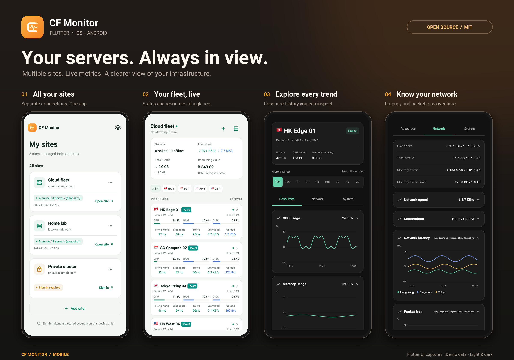

  

<h1 align="center">CF Monitor</h1>

服务器状态，随时掌握。

为 iOS 与 Android 打造的 CF-Server-Monitor Flutter 客户端。

  <strong>简体中文</strong> · <a href="README.en.md">English</a> 
  Flutter · iOS / Android · <a href="LICENSE">MIT 协议</a>

使用演示数据渲染的真实 Flutter 页面，展示明亮与暗黑主题；不包含生产环境凭据或服务器数据。

## 随身掌握服务器状态

- **一个 App，管理多个站点。** 添加公开或私有站点，凭据独立保存；可设置启动时直达的默认站点。
- **实时查看服务器。** 在线状态、CPU、内存、磁盘、网速、月流量及剩余价值一目了然，支持卡片／紧凑列表切换、分组与地区筛选。
- **可探索的历史图表。** 查看最近 10 分钟至 7 天的资源趋势，切换图例、触摸读取采样；有数据时展示 GPU 与磁盘 I/O。
- **查看网络质量。** 监控站点所配置线路的延迟与丢包率。
- **手机上完成服务器接入。** 登录后可新增或删除服务器，生成所支持系统的探针安装命令，并选择 GitHub 代理。
- **适合日常使用。** 支持中文／English、明亮／暗黑／跟随系统主题、偏好保存、WebSocket 重连及返回前台刷新。

## 下载与更新

- **Android**：[GitHub Releases](https://github.com/chaos-zhu/cf_monitor_app/releases/latest)
- **iOS**：https://apps.apple.com/app/cfmonitor/id6830518489CF-Server-Monitor 【非大陆apple store可用】

## 上游项目

CF Monitor 连接 [huilang-me/CF-Server-Monitor](https://github.com/huilang-me/CF-Server-Monitor)，感谢上游项目提供服务器监控服务与 API。

## 开源协议

移动端客户端及其原创 Logo 使用 [MIT 协议](LICENSE)。上游项目的版权与许可声明保留在 [THIRD_PARTY_NOTICES.md](THIRD_PARTY_NOTICES.md)，并随 App 一起打包。
